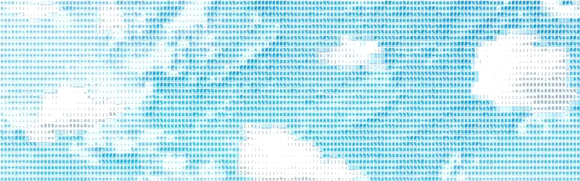
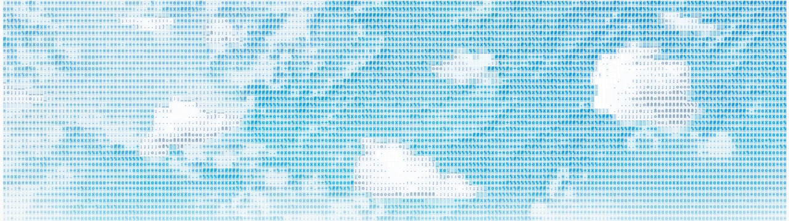
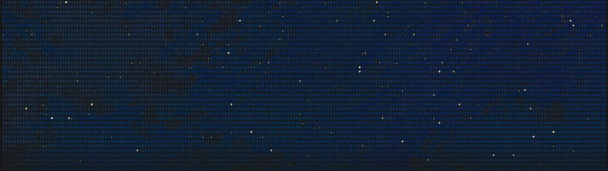
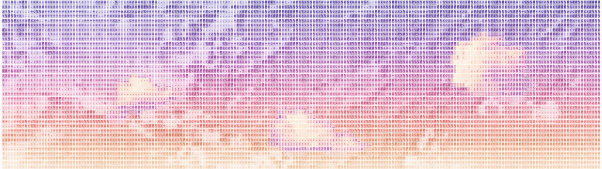

# ascii-sky

A painted blue sky in ASCII, drawn on a canvas. The clouds drift on the
wind, the pointer stirs the air, a click sends a gust across it, and at
night the stars twinkle.



It is the sky at the top of [unvalley.me](https://unvalley.me), taken out
of the site so anyone can use it.

| Day | Night | Sunset |
| --- | --- | --- |
|  |  |  |

- **A painting, as glyphs.** Open sky is a glyph and a tile of blue a cell,
  from `.:+*ox%#@` by how much blue the painting has there. The clouds were
  cut from the same painting and drift over it in two layers, near and far,
  changing shape as they go.
- **Edges drawn by shape.** Where cloud meets sky, each cell gets the glyph
  whose ink best matches the cloud's shape there, so a cloud's outline is
  drawn with `. , ' - _ ( )` and changes as the cloud moves.
- **Air you can stir.** Moving the pointer pushes the clouds aside and
  leaves streaks of wind (`- ~ / \ |`) that settle and spring back; a
  click or tap sends a gust running outward.
- **Three skies.** Day, a starry night (no clouds, stars that twinkle and
  now and then sparkle) and a violet-to-orange sunset. `auto` follows the
  visitor's colour scheme.
- **Light on the page.** Plain functions over typed arrays, no allocation
  in a frame. It draws at most 60 frames a second, 20 while the air is
  calm, 30 when frames run slow, and stops while it is off screen or the
  tab is hidden. With reduced motion it draws once and stays still.
  Working a frame out takes about 1.8 ms on a 1440 px wide page, 4.7 ms
  with the wind blowing (`pnpm bench`, Apple M3).

No dependencies. React is optional.

## Install

It is not on npm yet. Install it from GitHub (it builds on install):

```bash
npm install github:unvalley/ascii-sky
```

Recent pnpm installs it too, once you allow its build: pnpm stops and
prints the `allowBuilds` entry to add to `pnpm-workspace.yaml`.

The sky needs its five files (about 100 KB) served by your site. Copy the
package's `assets` folder to where your static files live:

```bash
cp -R node_modules/ascii-sky/assets public/ascii-sky
```

They are looked for at `/ascii-sky/` unless you say otherwise (`assets`
below). Their URLs carry a hash of their content (`?v=…`), so they can be
cached for good.

## Use

### Any page

Give it a canvas sized by CSS. The sky is centred in it, repeats sideways
on screens wider than 2400 px, and is 692 px tall.

```html
<canvas id="sky" style="position: absolute; inset: 0 0 auto; width: 100%; height: 692px"></canvas>
```

```ts
import { mountSky } from "ascii-sky";

const sky = mountSky(document.getElementById("sky") as HTMLCanvasElement, {
  assets: "/ascii-sky/",
  theme: "auto", // "light" | "dark" | "sunset" | "auto"
});

sky.setTheme("sunset"); // switch at any time
sky.stop(); // stop drawing and remove every listener
```

The canvas gets a `data-ready` attribute once the sky is first drawn, to
fade it in by:

```css
#sky { opacity: 0; transition: opacity 700ms; }
#sky[data-ready] { opacity: 1; }
```

### React

```tsx
import { AsciiSky } from "ascii-sky/react";

export function Hero({ dark }: { dark: boolean }) {
  return <AsciiSky theme={dark ? "dark" : "light"} assets="/ascii-sky/" style={{ height: 360 }} />;
}
```

`<AsciiSky>` is a box (as wide as its parent, 692 px tall unless you
style it) holding the canvas. With a theme named, the sky's colours show
from the first paint and the live sky fades in over them. Changing
`theme` switches the sky without restarting it. It works with server
rendering (`"use client"`); it needs React 18 or later (tested with 19). The box takes no
pointer events; the wind follows the pointer over the whole page.

### Options

| Option | Default | |
| --- | --- | --- |
| `theme` | `"auto"` | `"light"`, `"dark"`, `"sunset"`, or `"auto"` for the visitor's colour scheme. |
| `assets` | `"/ascii-sky/"` | The URL of the folder holding the sky's files, or `{ text, light, dark, near, far }` with each file's own URL (say, from your bundler). |
| `faintFrom` | the canvas's `--sky-faint` CSS property | Page pixels from the top of the canvas from which the sky is faint, say behind text under a fading mask. Rows below it are worked out every other frame. |
| `ignore` | links, buttons, form fields, `[role]` | A selector: clicks on matching elements are left to them, not taken as gusts. |
| `night` | `NIGHT` | The night's stars: their share of the sky, their colour, the wind's colour, and whether they sparkle. |

### A sky that fades into the page

On unvalley.me the sky is full strength across the top, then carries on
faintly behind the text and fades out. That is a CSS mask on a box around
the canvas, and `--sky-faint` tells the sky from where it can work faint
rows out half as often:

```css
:root { --sky-hero: 360px; --sky-faint: 400px; }
.sky-frame {
  mask-image: linear-gradient(
    to bottom,
    #000 calc(var(--sky-hero) - 60px),
    rgb(0 0 0 / 0.13) var(--sky-faint),
    rgb(0 0 0 / 0.065) calc(var(--sky-hero) + 300px),
    transparent
  );
}
```

The [demo](demo/index.html) puts it together.

### The sky's colours before it loads

`stillSky(theme, assets)` returns a style (`background`, `imageRendering`,
`opacity`) for an element behind the canvas that shows the sky's colours,
a pixel a cell, as pale on the whole as the live sky. Preload
`sky-light.webp` (or `sky-dark.webp`) and the page has its sky at first
paint; the live sky fades in over it. The sunset is a CSS gradient
(`sunsetGradient()`) and needs no file.

### Lower level

`loadSky(assets)` loads the files and returns the sky's cells;
`startSky(canvas, cells, SKY_WIDTH, SKY_CELL, options)` runs them. The
modules under `src/` are plain functions over plain data (the wind in
`air.ts`, the frame in `shade.ts`, the clock in `clock.ts`); only
`engine.ts` and `load.ts` touch the page.

## How it works

The still sky is the painting with its clouds taken out: a glyph a cell in
`sky.txt` and a colour a cell in `sky-light.webp` and `sky-dark.webp` (the
night is graded from the day in OKLab, `grade.ts`). The clouds are two
layers, `clouds-near.webp` and `clouds-far.webp`: red for how shaded, green
for how much cloud. They tile every 2400 px and drift at their own speeds,
with gusts, and are warped as they go, so no cloud keeps one shape.

Each frame works out one row in three of the sky (every row while the air
is calm), a glyph and a colour a cell, into typed arrays (`shade.ts`), then
stamps the changed cells' glyphs from an atlas and composites tiles, the
1 px gaps between them and the tinted glyphs onto the canvas (`paint.ts`).

The cloud edges follow Alex Harri's
[ASCII rendering](https://alexharri.com/blog/ascii-rendering): every glyph
is measured by how much ink it puts in six regions of its cell, and each
cell gets the glyph that best matches what the cloud wants there.

## Remaking the sky

`scripts/` turns a painted sky (1536 × 1024) into the sky's files, so you
can make one from your own picture. See [scripts/README.md](scripts/README.md).

## Develop

```bash
pnpm install
pnpm dev          # the demo, with the React one at /react.html
pnpm test         # node:test, 113 tests
pnpm check        # TypeScript
pnpm bench        # how long a frame takes to work out, without a browser
pnpm build        # dist/
```

Judge changes in a browser, not from stills. Animations stop in hidden
tabs and panes.

## License

[MIT](LICENSE), the code and the sky's images alike.
